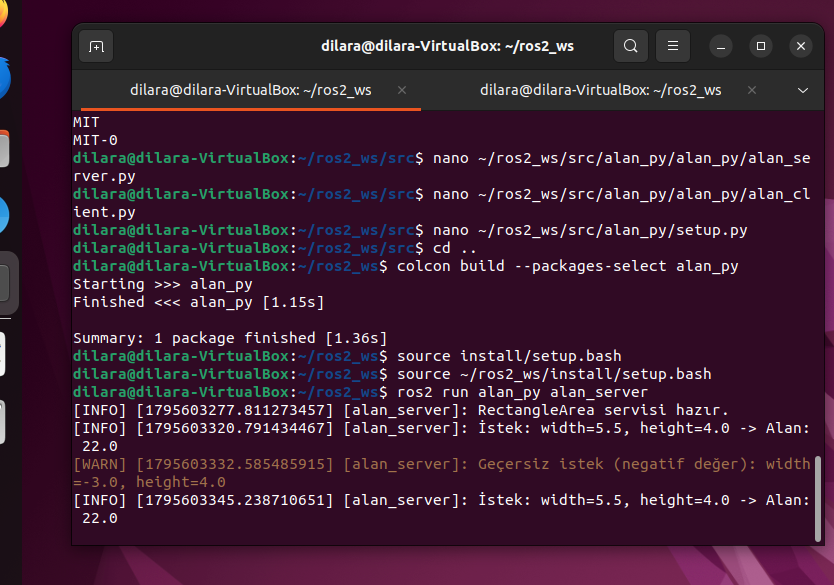
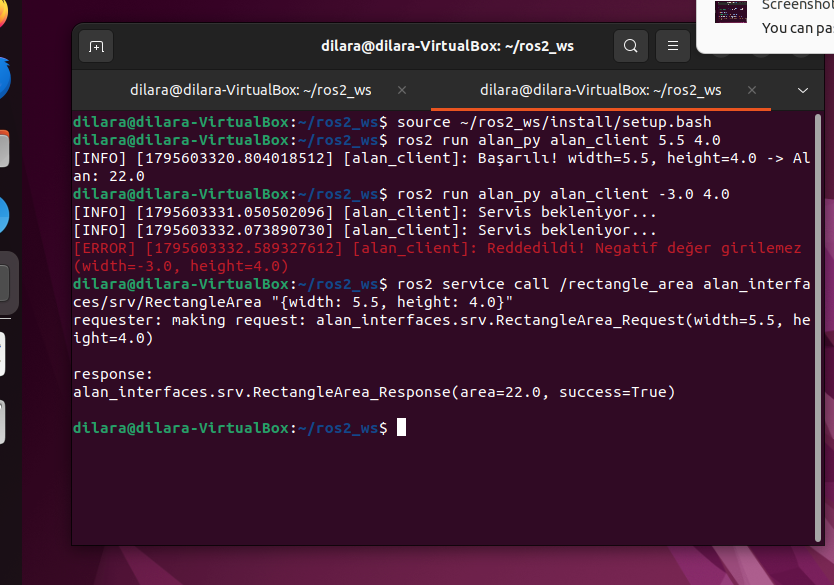

# RectangleArea Servisi (ROS 2 Ödev)

## Derleme ve Çalıştırma Komutları
```bash
cd ~/ros2_ws
colcon build --packages-select alan_interfaces alan_py
source install/setup.bash

# Sunucu
# RectangleArea Servisi (ROS 2 Ödev)

Bu proje, dikdörtgenin genişlik (`width`) ve yükseklik (`height`) değerlerini alarak alanını (`area`) hesaplayan bir ROS 2 servis (sunucu-istemci) uygulamasıdır. Negatif değer girildiğinde istek reddedilir ve `success: False` döndürülür.

## Paket Yapısı

* **alan_interfaces**: `RectangleArea.srv` servis arayüzünü içerir (`float64 width`, `float64 height` -> `float64 area`, `bool success`).
* **alan_py**: Servisi sunan `alan_server` düğümünü ve komut satırından parametre alarak servisi çağıran `alan_client` düğümünü içerir.

## Derleme ve Çalıştırma Komutları

### 1. Paketleri Derleme
```bash
cd ~/ros2_ws
colcon build --packages-select alan_interfaces alan_py
source install/setup.bash
```

### 2. Sunucuyu Başlatma (1. Terminal)
```bash
source ~/ros2_ws/install/setup.bash
ros2 run alan_py alan_server
```

### 3. İstemciyi Çalıştırma (2. Terminal)
```bash
source ~/ros2_ws/install/setup.bash

# Pozitif değer testi
ros2 run alan_py alan_client 5.5 4.0

# Negatif değer testi (Bonus - reddedilir)
ros2 run alan_py alan_client -3.0 4.0
```

## `ros2 service call` Doğrulama Çıktısı

Komut:
```bash
ros2 service call /rectangle_area alan_interfaces/srv/RectangleArea "{width: 5.5, height: 4.0}"
```

Çıktı:
```text
requester: making request: alan_interfaces.srv.RectangleArea_Request(width=5.5, height=4.0)

response:
alan_interfaces.srv.RectangleArea_Response(area=22.0, success=True)
```

## Terminal Ekran Görüntüleri

### Sunucu Çıktısı


### İstemci ve Doğrulama Çıktısı
ros2 run alan_py alan_server

# İstemci
ros2 run alan_py alan_client 5.5 4.0


